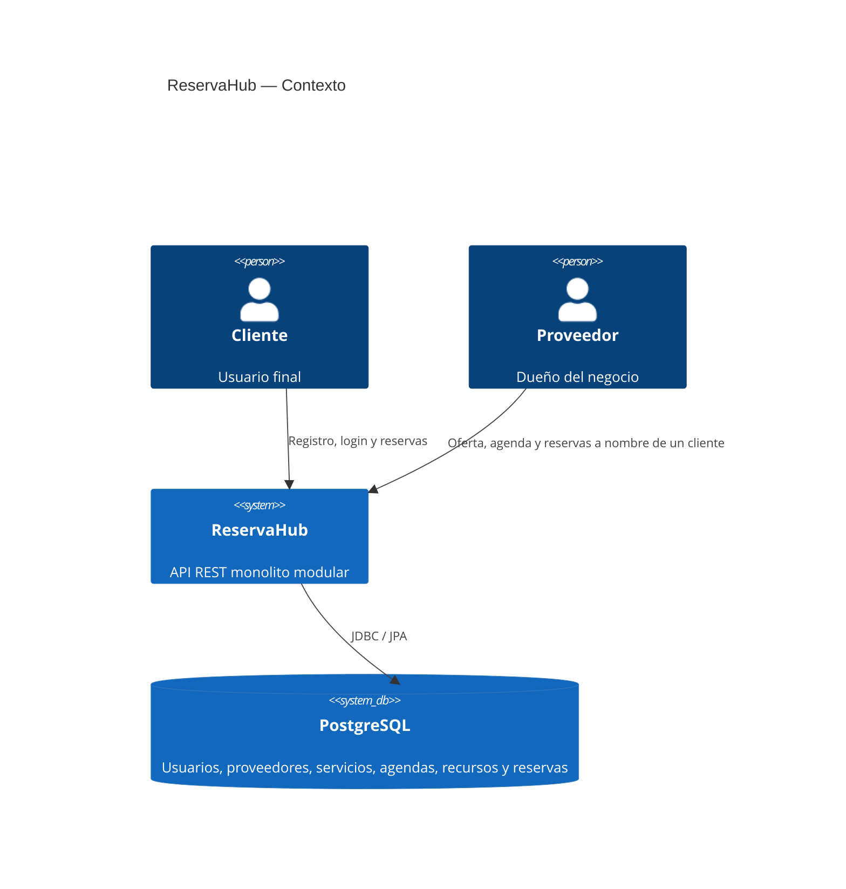
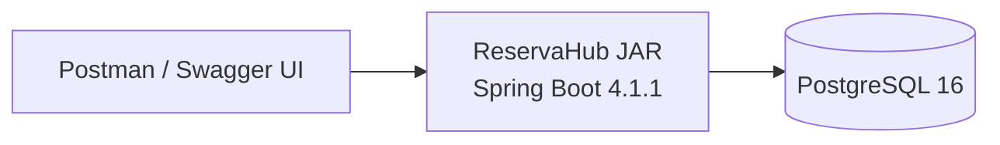
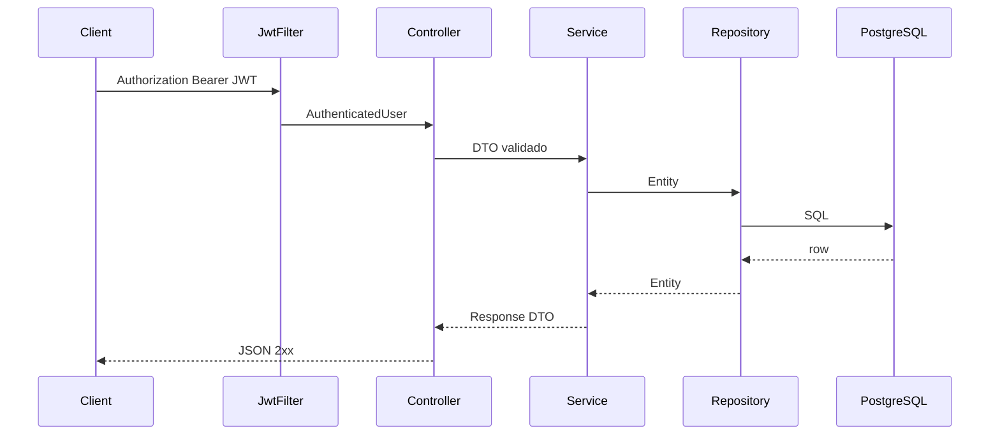
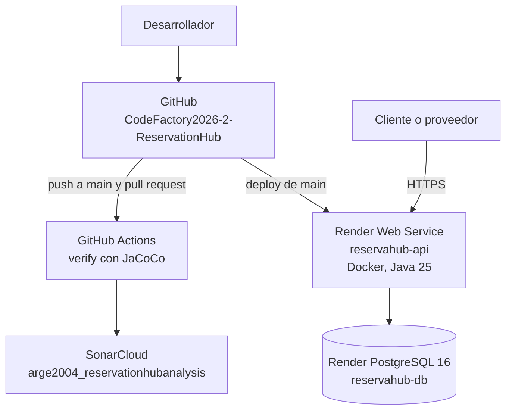

# Diagramas de arquitectura (C4 ligero / UML textual)

Los diagramas reflejan los componentes implementados hasta el Sprint 2, reservas incluidas. El módulo `report` sigue como placeholder.

## Diagrama de contexto



## Diagrama de contenedores



## Diagrama de paquetes

```text
co.udea.codefactory.reservahub
├── user
├── provider
├── servicecatalog
├── schedule
├── resource
├── reservation   (activo desde Sprint 2)
├── report        (placeholder)
├── security
├── audit
├── observability
└── shared
```

## Diagrama de componentes (request autenticada de proveedor)



## Diagrama de despliegue

Producción del Sprint 2. El servicio ya está en Render. GitHub Actions (`.github/workflows/sonarcloud.yml`) compila, corre las pruebas con JaCoCo y publica el análisis en SonarCloud. El diagrama incluye también los pull requests hacia `develop` y `main`: ese disparador entra con el cambio de CI.



En local, `docker compose` sigue levantando la API y PostgreSQL 16 en la máquina del desarrollador. Ese camino no reemplaza el diagrama de arriba.
